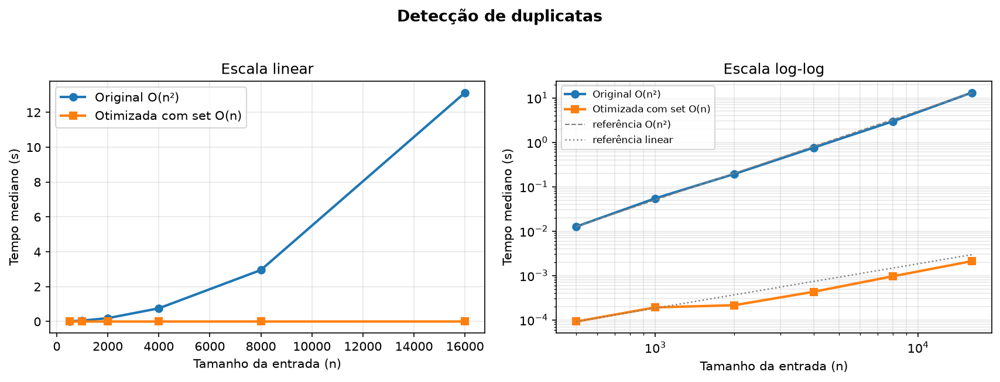
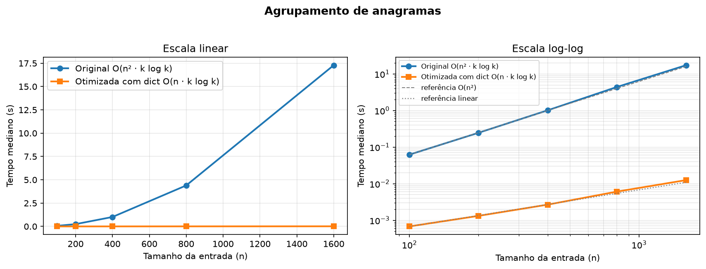

# Detecção de duplicatas e anagramas

## Diagnóstico e primeira otimização

**Integrantes:** William Araújo Gonçalves da Silva, Kelvin Moreira dos Santos Oliveira, Marcos Henrique Gonçalves da Silva

<!--
Tempo: 30 s.
Apresentar o tema e o objetivo: sair de uma solução O(n²) e comprovar o ganho
com medições, não apenas com argumentos teóricos.
-->

---

## O problema

- **Duplicatas:** existe algum valor repetido em uma sequência?
- **Anagramas:** quais palavras têm as mesmas letras em ordem diferente?

Em ambos os casos, precisamos detectar **equivalência** entre itens.

A solução ingênua compara todos os pares. A solução eficiente transforma cada
item em uma **chave** e usa uma tabela de hash.

**Evolução desde a Entrega 1:** código original → primeira otimização →
testes de equivalência + benchmark + análise dos limites.

<!--
Tempo: 40 s.
Destacar a ideia comum: comparação direta repetida versus chave + hash.
-->

---

## Versão original: duplicatas

```python
def tem_duplicata(lista):
    for i in range(len(lista)):
        for j in range(i + 1, len(lista)):
            if lista[i] == lista[j]:
                return True
    return False
```

- Pior caso: `n(n-1)/2` comparações
- Complexidade: **O(n²)**
- Espaço adicional: O(1)

<!--
Tempo: 45 s.
Mostrar a contagem de comparações. Se não há duplicatas, todos os pares são
comparados. O melhor caso é O(1), mas o pior caso domina para entradas grandes.
-->

---

## Versão original: anagramas

```python
for palavra in palavras:
    for grupo in grupos:
        chave_palavra = tuple(sorted(normalizar(palavra)))
        chave_grupo = tuple(sorted(normalizar(grupo[0])))
        if chave_palavra == chave_grupo:
            grupo.append(palavra)
            break
    else:
        grupos.append([palavra])
```

- Busca linear nos grupos: O(n²) comparações
- Normalização + ordenação refeitas a cada comparação: O(k log k)
- Total: **O(n² · k log k)**

<!--
Tempo: 45 s.
O gargalo é duplo: buscar o grupo e recalcular a chave da mesma palavra várias
vezes. A normalização é necessária, mas pode ser feita uma única vez.
-->

---

## Como medimos

- `time.perf_counter`, após aquecimento
- Várias repetições; reportamos a **mediana**
- Funções rápidas: várias execuções por medição
- Pior caso: listas sem duplicatas e palavras com chaves distintas
- Correção verificada com `pytest`

<!--
Tempo: 40 s.
Explicar que medir uma vez é ruído. A mediana reduz o efeito de picos de carga.
Os testes garantem que a versão otimizada não altera o resultado.
-->

---

## Primeira otimização: duplicatas com `set`

```python
def tem_duplicata_hash(lista):
    vistos = set()
    for item in lista:
        if item in vistos:
            return True
        vistos.add(item)
    return False
```

- Consulta e inserção em `set`: O(1) amortizado esperado
- Tempo: **O(n)**
- Espaço: O(n)
- Trade-off: troca memória por tempo

<!--
Tempo: 50 s.
O conjunto funciona como memória do que já foi visto. Cada elemento entra uma
vez e é consultado uma vez. O custo de espaço é o preço da linearidade.
-->

---

## Primeira otimização: anagramas com chave + `dict`

```python
def chave_anagrama(palavra):
    return tuple(sorted(normalizar_palavra(palavra)))


def agrupar_anagramas_hash(palavras):
    grupos = {}
    for palavra in palavras:
        grupos.setdefault(chave_anagrama(palavra), []).append(palavra)
    return list(grupos.values())
```

- Normalização: `casefold`, sem acentos, apenas letras/dígitos
- Chave calculada **uma vez** por palavra
- Tempo: **O(n · k log k)**; com `k` fixo, linear em `n`

<!--
Tempo: 50 s.
A chave normalizada é o ponto central: "Ação" e "acao" produzem a mesma tupla
ordenada. O dicionário faz a busca do grupo em tempo constante esperado.
-->

---

## Resultados: duplicatas

| n | Original | Otimizada | Ganho |
|---:|---:|---:|---:|
| 500 | 12,63 ms | 92,0 µs | 137,2× |
| 4.000 | 757,99 ms | 430,2 µs | 1.762,1× |
| 16.000 | 13,132 s | 2,10 ms | 6.240,9× |

- Ao dobrar `n`, o original cresce ~4×; a versão com `set` cresce ~2×
- O ganho cresce com o tamanho da entrada

<!--
Tempo: 50 s.
Apontar a última linha: 13 segundos contra 2 milissegundos. Não é só uma
constante melhor; a inclinação da curva mudou.
-->

---

## Resultados: anagramas

| n | Original | Otimizada | Ganho |
|---:|---:|---:|---:|
| 100 | 62,38 ms | 680,6 µs | 91,7× |
| 400 | 1,014 s | 2,68 ms | 378,2× |
| 1.600 | 17,286 s | 12,53 ms | 1.379,1× |

- O original refaz a chave a cada comparação
- A versão com `dict` calcula a chave uma vez e agrupa

<!--
Tempo: 40 s.
Aqui o ganho é menor que em duplicatas porque a normalização e a ordenação
continuam custando O(k log k), mas o fator O(n²) desaparece.
-->

---

## Gráficos: linear e log-log





<!--
Tempo: 40 s.
Na escala log-log, a inclinação da curva original fica próxima de 2 e a da
otimizada próxima de 1. As linhas de referência ajudam a visualizar isso.
-->

---

## Como rodar e testar

```bash
# correção: casos fixos + entradas aleatórias
python3 -m pytest -q
python3 -m pytest tests/test_duplicatas.py tests/test_anagramas.py -q

# desempenho: grava em resultados/local/
python3 -m src.benchmark --rapido --sem-grafico
python3 -m src.benchmark

# cenários de limite (Parte 2)
python3 -m src.limites --rapido
```

- `pytest`: correção; `benchmark`: tempo; `limites`: cenários da Parte 2
- `--rapido` é o modo seguro para demonstração ao vivo
- `--publicar` atualiza a referência; use de propósito
- Detalhes e instalação: `README.md`

<!--
Tempo: 40 s.
Mostrar rapidamente os comandos e deixar claro o que é teste de correção e o
que é medição. Se o tempo apertar, este slide pode ficar só como apoio.
-->

---

## O ganho tem limites (teaser)

- O benchmark mede o **pior caso sintético**
- Duplicata no início: a original retorna em microssegundos; ganho ~1,5×
- Todas as palavras no mesmo grupo: o ganho cai para ~2×
- A versão otimizada usa O(n) de memória
- **6.240× é o ganho neste cenário, não uma propriedade universal**

> A Parte 2 aprofunda cada um desses limites.

<!--
Tempo: 40 s.
Sem entrar em detalhes: apenas plantar as quatro perguntas que a Parte 2
responde (entrada, memória, hash/semântica e validade do experimento).
-->

---

## Conclusão da Parte 1

- A primeira otimização elimina as comparações repetidas
- `set` e `dict` levam de O(n²) para O(n) esperado
- Em anagramas, O(n²·k log k) → O(n·k log k)
- O ganho medido cresce com `n` (até **6.240,9×** em duplicatas)

**A mudança não é só de constante: a inclinação da curva mudou.**

<!--
Tempo: 30 s.
Fechar a Parte 1 com a mensagem principal: medimos, identificamos o gargalo e
comprovamos o ganho no cenário de pior caso.
-->

---

## Fim da Parte 1 — início da Parte 2

**Parte 1:** funciona, é mais rápido e o ganho aparece nos gráficos.

**Parte 2:** quando esse ganho desaparece?

- distribuição da entrada (duplicata cedo × tarde)
- memória e cache
- pior caso do hash e contrato de igualdade
- custo residual da chave
- validade do experimento

<!--
Tempo: 30 s.
Transição explícita: "A Parte 1 termina aqui. A Parte 2 começa com a pergunta
mais difícil: quando esse ganho desaparece?" Não agradecer ainda se a Parte 2
for emendada.
-->

---

<!-- _class: lead -->

# Parte 2

## Aprofundamento e limites do ganho

**William · Kelvin · Marcos**

> Ganho é uma razão, não uma constante.

*Números exploratórios de `src/limites.py`; variam com a máquina.*

<!--
Tempo: 35 s.
Retomar a tese: o número de 6.240× é verdadeiro no cenário medido, mas não é
uma propriedade universal. A Parte 2 separa ganho assintótico de ganho medido.
-->

---

## A fórmula do ganho: duplicatas

No pior caso (sem duplicatas):

- Original: `T_o(n) ≈ c_o · n²/2` → **O(n²)**
- Com `set`: `T_h(n) ≈ c_h · n + c_s` → **O(n) esperado**

```text
S(n) = T_original(n) / T_hash(n) ≈ (c_o / 2c_h) · n
```

- O ganho **cresce linearmente com n**
- 137× em n=500 e 6.240× em n=16.000 seguem a mesma tendência linear
- Não existe “o ganho da otimização”: existe o ganho **neste cenário**

<!--
Tempo: 45 s.
Explicar por que os dois números não se contradizem. O ganho é uma razão que
depende de n; não é uma constante do algoritmo.
-->

---

## O limite do melhor caso: duplicata cedo × tarde

| Cenário (n=4.000) | Original | Com `set` | Ganho |
|---|---:|---:|---:|
| duplicata no início | 0,63 µs | 0,46 µs | 1,4× |
| duplicata no fim | 781,44 ms | 429,15 µs | 1.820,9× |

- Cedo: a original retorna quase imediatamente; o ganho desaba
- A diferença fica na casa de microssegundos e pode inverter por constantes
- O benchmark de pior caso **escolhe** a segunda linha
- Em dados reais, a posição da primeira duplicata é uma variável

<!--
Tempo: 50 s.
Se a duplicata está nas primeiras posições, o termo O(n²) não aparece. O ganho
de milhares de vezes cai para ~1,5×. Em outra execução a original pode ficar
alguns por cento à frente; isso é ruído de constantes, não de complexidade.
-->

---

## O preço em memória: O(n) não é de graça

| Medida (tracemalloc) | Original | Otimizada |
|---|---:|---:|
| Duplicatas, n=4.000 | 0,1 KiB | 160,2 KiB |
| Anagramas, n=400 | 24,5 KiB | 52,0 KiB |

- Duplicatas: cerca de 40 bytes por elemento; 1 milhão ≈ dezenas de MB
- Anagramas: chaves + listas de grupos, O(n·k)
- Em memória limitada ou fluxo contínuo, o espaço pode decidir
- Troca explícita: **tempo × espaço**

<!--
Tempo: 40 s.
Lembrar que a versão original é O(1) de espaço adicional. A otimizada compra
tempo com memória; em alguns ambientes essa compra não é possível.
-->

---

## Pior caso do hash e contrato de igualdade

- `set`/`dict`: O(1) **esperado e amortizado**, não garantido
- Pior caso teórico com colisões: O(n) por operação → O(n²) no total
- Inteiros: hash é o próprio valor; strings: hash aleatorizado (SipHash)
- Entrada adversarial pode se aproximar do pior caso

**Semântica:**

| Caso | Original | Com `set` |
|---|---|---|
| `[nan, nan]` (mesmo objeto) | `False` | `True` |
| `[[1], [1]]` | `True` | `TypeError` |

- `set` usa identidade antes de igualdade; `nan != nan`
- “Correto” depende do contrato de igualdade e de os dados serem hashable

<!--
Tempo: 50 s.
Este é o ponto mais delicado: a otimização não é semanticamente equivalente
para todo tipo de dado. Nos testes usamos inteiros e strings; NaN, objetos com
__eq__/__hash__ inconsistentes e listas aninhadas exigem decisão explícita.
-->

---

## Anagramas: o custo que sobra

- Original: O(n²) visitas × O(k log k) por visita → **O(n²·k log k)**
- Com `dict`: chave calculada uma vez → **O(n·k log k)**
- O termo O(n²) desaparece; o O(k log k) **fica**
- Por isso o ganho é menor que em duplicatas

| Cenário (n=400) | Original | Com `dict` | Ganho |
|---|---:|---:|---:|
| todas em grupos distintos | 1,094 s | 3,43 ms | 318,6× |
| todas no mesmo grupo | 4,82 ms | 2,44 ms | 2,0× |

<!--
Tempo: 45 s.
Quando todas as palavras são anagramas entre si, a original encontra o grupo na
primeira comparação e não paga O(n²). O ganho cai para ~2×. O benchmark usa
palavras aleatórias de 8 letras, ou seja, o pior caso.
-->

---

## A chave: ordenar O(k log k) × contar O(k)

| k (1.000 palavras) | `sorted` | contagem | `sorted`/contagem |
|---:|---:|---:|---:|
| 8 | 1,29 ms | 1,91 ms | 0,7× |
| 32 | 5,50 ms | 5,94 ms | 0,9× |
| 128 | 31,81 ms | 19,49 ms | 1,6× |
| 512 | 147,73 ms | 80,87 ms | 1,8× |

> Na última coluna, `sorted`/contagem < 1 significa que `sorted` foi mais rápido.

- Assintoticamente, contar é melhor: O(k) contra O(k log k)
- Na prática, a constante da contagem só compensa para k grande
- No benchmark k=8: trocar a chave **pioraria** o tempo
- Complexidade assintótica não é a única métrica

<!--
Tempo: 45 s.
Este é o exemplo mais claro de "limite do ganho": uma melhoria assintótica pode
não aparecer no regime medido. Para k=8, sorted ganha; para k=128 e 512, a
contagem ganha. A escolha ideal é adaptativa.
-->

---

## O que o experimento prova — e o que não prova

**Prova (dentro do cenário):**

- a tendência de crescimento prevista pela análise
- inclinações log-log ≈ 1,98 × 0,87 (duplicatas) e 2,04 × 1,06 (anagramas)
- o ganho cresce com n no pior caso sintético

**Não prova:**

- intervalo de confiança, múltiplas máquinas ou múltiplas sementes
- melhor caso, caso médio, taxa real de duplicatas
- distribuição real dos grupos de anagramas
- memória, latência de cauda ou custo de inicialização

> Uma máquina, uma semente, uma distribuição: validade externa limitada.

<!--
Tempo: 50 s.
As inclinações são descritivas: confirmam o formato, não são prova estatística.
Entre 1.000 e 2.000 a versão otimizada cresceu 1,12×, e não 2×; o relatório
registra que isso não foi investigado. É ruído/cache/alocação, não mudança de
complexidade.
-->

---

## Limites teóricos

- Duplicatas: é preciso ler os n elementos → **Ω(n)**
  - `set` atinge O(n) esperado: ótimo a menos de constantes
- Anagramas: é preciso ler n palavras de tamanho k → **Ω(n·k)**
  - versão atual O(n·k log k); contagem chega a O(n·k)
- Não há ganho infinito: o custo residual e as constantes limitam
- O ganho assintótico não diz nada sobre o ponto de operação real

**Espaço, cache e paralelismo:**

- `set`/`dict` não cabem no cache quando n cresce → mais cache misses
- Threads não ajudam em Python puro por causa do GIL
- Multiprocessing tem custo de serialização e junção

<!--
Tempo: 50 s.
Separar limite inferior de tempo do limite do ganho. Em duplicatas, O(n) é
ótimo; em anagramas, ainda há espaço para O(n·k), mas só para k grande. E o
O(1) do hash não é O(1) de cache.
-->

---

## Trade-offs

| Dimensão | Original | Otimizada |
|---|---|---|
| Tempo (pior caso) | O(n²) | O(n) esperado |
| Espaço adicional | O(1) | O(n) |
| Legibilidade | laços simples | chave + hash; ainda direta |
| Contrato dos dados | qualquer comparável | hashable + igualdade consistente |
| Pior caso determinístico | O(n²) | O(n²) teórico com colisões |
| Cache/memória | melhor | pior quando n cresce |
| Manutenção | menos conceitos | hash, chave e normalização |

> A otimização é simples, mas não é “de graça”: ela muda o contrato e o custo
> de espaço. Legibilidade e desempenho não são opostos aqui; o risco é
> micro-otimizar sem medir.

<!--
Tempo: 40 s.
Este slide responde diretamente ao trade-off tempo × espaço e legibilidade ×
desempenho. A versão otimizada continua legível; o custo real é memória e
contrato de dados. O pior caso determinístico do hash é O(n²) teórico.
-->

---

## Checklist: quando não otimizar

- n pequeno: constantes dominam; meça antes
- duplicata provável no início: a original já retorna cedo
- todas as palavras no mesmo grupo: o termo O(n²) não aparece
- memória limitada ou dados em fluxo: O(n) pode ser proibitivo
- elementos não hashable: a versão com `set` falha
- igualdade com casos especiais (NaN, `__eq__`/`__hash__` inconsistentes)
- entrada adversarial: pior caso do hash
- necessidade de garantia determinística de pior caso

> Otimizar é trocar um custo por outro; a escolha depende do cenário.

<!--
Tempo: 40 s.
Não é uma lista de proibições: é um checklist para medir antes de decidir.
-->

---

## Como rodar e testar (reprodução)

```bash
python3 -m pytest -q                 # todos os testes
python3 -m src.benchmark --rapido    # benchmark curto
python3 -m src.benchmark             # benchmark completo
python3 -m src.limites               # cenários da Parte 2
python3 -m src.limites --rapido      # versão de palco
```

Com `make`:

```bash
make test
make bench-rapido
make bench
make limites
```

- Saída padrão: `resultados/local/` (ignorada pelo git)
- `--publicar`: atualiza `resultados/` de referência
- Teste prova equivalência; benchmark mede tempo; `limites` mede cenários

<!--
Tempo: 45 s.
Explicar o que cada comando faz e o que ele não prova. O benchmark completo é
longo; para palco, use --rapido. O src.limites produz as tabelas desta Parte 2.
-->

---

## Demo segura

1. **Antes de entrar:** rode `python3 -m src.benchmark --rapido` e abra
   `resultados/local/`
2. **No palco:** `python3 -m pytest -q` e `python3 -m src.limites --rapido`
3. **Mostre:** `resultados/local/resumo.md` e um CSV
4. **Evite:** rodar o benchmark completo ao vivo (dezenas de segundos)

> Se faltar `pytest`, use o devcontainer ou
> `python3 -m pip install -r requirements.txt`.

<!--
Tempo: 30 s.
A demo é opcional; se a máquina falhar, os gráficos e as tabelas já estão nos
slides. O importante é mostrar que os números são reproduzíveis.
-->

---

## Próximos experimentos

- várias sementes, várias máquinas e intervalo de confiança
- alternar as versões para reduzir deriva térmica
- medir memória em todos os tamanhos com `tracemalloc`
- `cProfile` / `line_profiler` para achar o novo gargalo
- variar a posição da duplicata e o número de grupos
- testar a chave adaptativa: `sorted` para k pequeno, contagem para k grande

<!--
Tempo: 40 s.
O próximo passo não é "otimizar mais": é medir melhor. A validade externa é a
maior fragilidade do trabalho atual.
-->

---

## Próximas implementações

- chave adaptativa por k (limiar medido, não chutado)
- fluxo/streaming: ordenação externa ou filtro de Bloom (com falsos positivos)
- dados numéricos: `array`/NumPy para reduzir custo por elemento
- paralelismo por blocos com `multiprocessing`, se o volume justificar
- testes explícitos para NaN, tipos não hashable e `__eq__`/`__hash__`
- medir o cenário real antes de escolher a versão

> Primeiro medir; depois otimizar; depois medir de novo.

<!--
Tempo: 35 s.
Fechar a parte de melhorias com a ideia de que a otimização é um processo
empírico, não uma receita.
-->

---

## Conclusão da Parte 2

- O ganho é **real**, mas **condicional**
- Grande no pior caso, com n grande e memória disponível
- Encolhe com duplicata cedo, grupos iguais, k pequeno ou memória escassa
- A ordem de crescimento muda; o custo residual e o espaço não desaparecem
- O número de 6.240× é uma medição, não uma garantia

> “Mais rápido para quê, em qual entrada, com qual memória e com qual
> garantia?”

<!--
Tempo: 40 s.
Fechamento: separar otimização de benchmark bonito. Agradecer e abrir para
perguntas.
-->

---

## Perguntas frequentes

- **A versão otimizada é pior no melhor caso?** O ganho cai para ~1,5× e pode
  empatar ou inverter por constantes; ela não é assintoticamente pior.
- **Por que não contar letras sempre?** Em k=8 a contagem foi ~1,5× mais lenta.
- **O `set` é O(1)?** Esperado/amortizado; pior caso teórico O(n).
- **Os testes provam correção?** Provam nos casos testados; NaN e contratos
  exóticos exigem decisão explícita.
- **Qual a maior limitação?** Pior caso sintético, uma máquina, uma semente,
  sem memória nem distribuição real.
- **Como saber o ganho no meu caso?** Meça a distribuição real e use
  `src.limites` como ponto de partida.

<!--
Tempo: respostas curtas; se a banca aprofundar, usar o roteiro de
aprofundamento como apoio.
-->
