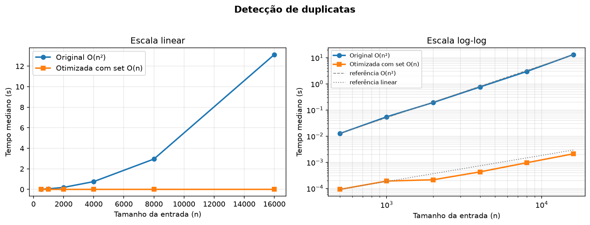
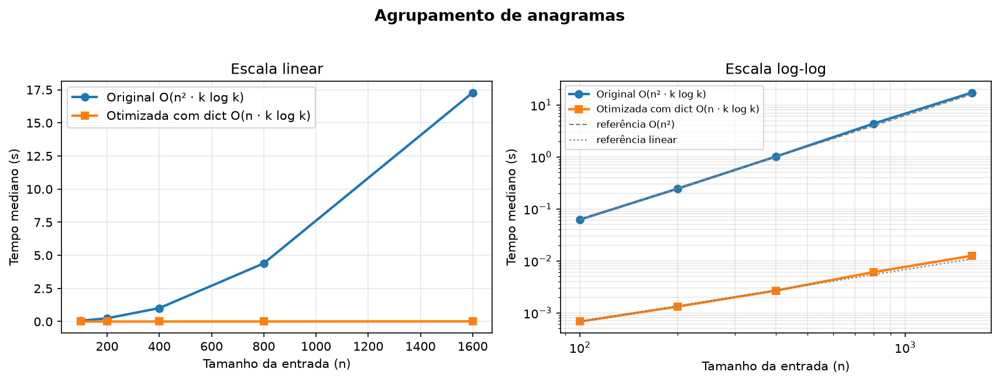

# AV2 — Diagnóstico e Primeira Otimização

## Detecção de duplicatas e agrupamento de anagramas

**Integrantes:** _preencher com os nomes do grupo_  
**Disciplina:** Análise de Algoritmos  
**Data:** 30/10/2026

---

## 1. Resumo

Este trabalho diagnostica e otimiza duas operações relacionadas ao tema de
duplicatas e anagramas. A primeira versão de cada operação foi implementada da
forma mais direta: comparação de todos os pares, no caso de duplicatas, e
comparação de cada palavra com todos os grupos já formados, no caso de
anagramas. As duas versões originais têm custo quadrático no pior caso. A
primeira otimização substitui as comparações repetidas por estruturas de hash: um
`set` para lembrar elementos já vistos e um `dict` cuja chave é a forma
normalizada da palavra. As medições mostram que, ao dobrar o tamanho da
entrada, o tempo da versão original cresce aproximadamente quatro vezes,
enquanto o da versão otimizada cresce aproximadamente duas vezes. Na maior
entrada testada em cada tarefa, o ganho observado foi de **6.240,9×** para
duplicatas e de **1.379,1×** para anagramas.

## 2. Descrição do problema

O projeto tem duas tarefas:

1. **Detecção de duplicatas.** Dada uma sequência de elementos, responder se
   existe algum valor repetido. A versão fornecida no enunciado percorre todos
   os pares `(i, j)` com `j > i` e compara os valores.
2. **Agrupamento de anagramas.** Dada uma lista de palavras, agrupar aquelas
   que são anagramas entre si, ou seja, que possuem as mesmas letras em ordem
   diferente. A versão original compara cada palavra com o representante de
   cada grupo já existente, refazendo a normalização e a ordenação das letras
   em cada comparação.

A versão de duplicatas é a fornecida no enunciado. A versão de anagramas foi
implementada como extensão do tema, seguindo a mesma lógica de comparação
ingênua para que o diagnóstico e a otimização pudessem ser comparados.

Nos dois casos, o problema é detectar equivalência entre itens. A solução
ineficiente faz isso por comparação direta repetida; a solução eficiente
transforma cada item em uma **chave** e usa uma tabela de hash para verificar
equivalência em tempo constante esperado.

## 3. Metodologia

As implementações estão em `src/duplicatas.py` e `src/anagramas.py`. Para cada
tarefa foram mantidas duas funções: a versão original e a versão otimizada. A
correção foi verificada com testes automatizados (`pytest`), incluindo casos
fixos, listas vazias, palavras repetidas, diferenças de maiúsculas/acentos e
comparações aleatórias entre as duas versões.

As medições usam `time.perf_counter`, que é o relógio de maior resolução
disponível na biblioteca padrão. O procedimento é:

1. executar a função uma vez para aquecimento;
2. repetir a medição várias vezes;
3. para funções muito rápidas, executar a função várias vezes por medição e
   dividir o tempo total pelo número de execuções;
4. reportar a **mediana** das repetições, que é menos sensível a picos de
   carga do sistema.

Os benchmarks completos usam listas com `n` inteiros distintos embaralhados
(duplicatas) e `n` palavras aleatórias de 8 letras (anagramas). Esses são os
piores casos para as versões originais: sem duplicatas, a versão original
precisa comparar todos os pares; com palavras de chaves distintas, ela precisa
percorrer todos os grupos. O código está em `src/benchmark.py` e os resultados
são gravados em `resultados/`.

**Ambiente de referência:** Python 3.14.8, Linux 7.2.11-arch1-1, processador
Intel Core i5-1135G7 (8 CPUs). O devcontainer do projeto usa Python 3.12;
por isso, os tempos absolutos podem variar, mas a tendência de crescimento e
a ordem de grandeza dos ganhos se mantêm.

## 4. Análise da complexidade da versão original

### 4.1 Detecção de duplicatas

```python
def tem_duplicata(lista):
    for i in range(len(lista)):
        for j in range(i + 1, len(lista)):
            if lista[i] == lista[j]:
                return True
    return False
```

No pior caso, não há duplicatas e o algoritmo executa

`n + (n - 1) + ... + 1 = n(n - 1) / 2 = O(n²)`

comparações. O melhor caso é O(1): se os dois primeiros elementos forem iguais,
a função retorna imediatamente. O caso médio depende da distribuição dos dados;
para entradas sem duplicatas, que é o cenário usado no benchmark, o custo é
quadrático. O espaço adicional é O(1), pois só são usadas as variáveis de
controle dos laços.

O gargalo é a **repetição de comparações**: cada elemento é comparado com todos
os seguintes, mesmo que já tenha sido comparado indiretamente com vários
outros. Não há memória do que já foi visto.

### 4.2 Agrupamento de anagramas

```python
for palavra in palavras:
    for grupo in grupos:
        chave_palavra = tuple(sorted(normalizar_palavra(palavra)))
        chave_grupo = tuple(sorted(normalizar_palavra(grupo[0])))
        if chave_palavra == chave_grupo:
            grupo.append(palavra)
            break
    else:
        grupos.append([palavra])
```

No pior caso, cada palavra cai em um grupo novo. A primeira palavra compara-se
com 0 grupos, a segunda com 1, e assim por diante, totalizando O(n²)
comparações. Cada comparação refaz a normalização e a ordenação de duas
palavras de comprimento `k`, com custo O(k log k). O custo total é, portanto,
O(n² · k log k). O espaço adicional é O(n) para as listas de grupos (as
palavras já estão na entrada).

O gargalo é duplo: (i) a busca linear pelos grupos e (ii) o recálculo da chave
da mesma palavra e do mesmo representante várias vezes. A normalização é
importante para o problema — maiúsculas, acentos e pontuação não deveriam
alterar o resultado —, mas ela não precisa ser refeita a cada comparação.

## 5. Primeira otimização

### 5.1 Duplicatas com `set`

```python
def tem_duplicata_hash(lista):
    vistos = set()
    for item in lista:
        if item in vistos:
            return True
        vistos.add(item)
    return False
```

O conjunto `vistos` guarda os elementos já percorridos. A consulta `item in
vistos` e a inserção `vistos.add(item)` têm custo O(1) amortizado esperado.
Assim, o algoritmo faz uma passagem pela lista e tem complexidade de tempo
O(n) esperada. O espaço adicional passa de O(1) para O(n), o que é o
trade-off necessário para eliminar as comparações repetidas.

A versão assume que os elementos são *hashable* (inteiros, strings, tuplas
etc.). Para elementos mutáveis, como listas, seria necessário convertê-los
para uma representação imutável antes de inserir no conjunto.

### 5.2 Anagramas com chave normalizada e `dict`

```python
def chave_anagrama(palavra):
    return tuple(sorted(normalizar_palavra(palavra)))

def agrupar_anagramas_hash(palavras):
    grupos = {}
    for palavra in palavras:
        grupos.setdefault(chave_anagrama(palavra), []).append(palavra)
    return list(grupos.values())
```

A normalização aplica `casefold`, remove acentos e descarta caracteres que não
sejam letras ou dígitos. Depois, as letras são ordenadas e transformadas em uma
tupla, que é hashable. Palavras que são anagramas produzem exatamente a mesma
chave; palavras que não são, produzem chaves diferentes. O dicionário associa
cada chave ao grupo correspondente.

Cada palavra é normalizada e ordenada uma única vez, com custo O(k log k). O
custo total é O(n · k log k); o espaço adicional é O(n · k) para as chaves e
O(n) para as listas de grupos. Quando o
comprimento das palavras é pequeno e fixo, como no benchmark (`k = 8`), o custo
é linear em `n`. Essa é a primeira otimização; uma evolução possível é trocar a
ordenação por uma chave de contagem de caracteres, obtendo O(n · k).

## 6. Resultados

### 6.1 Detecção de duplicatas

*Tabela 1 — Tempos medianos da detecção de duplicatas (pior caso, sem
duplicatas).*

| n | Original | Otimizada | Ganho |
|---:|---:|---:|---:|
| 500 | 12,63 ms | 92,0 µs | 137,2× |
| 1.000 | 54,75 ms | 191,7 µs | 285,7× |
| 2.000 | 194,06 ms | 214,7 µs | 903,9× |
| 4.000 | 757,99 ms | 430,2 µs | 1.762,1× |
| 8.000 | 2,955 s | 960,1 µs | 3.077,8× |
| 16.000 | 13,132 s | 2,10 ms | 6.240,9× |



*Figura 1 — Tempos medianos da detecção de duplicatas em escala linear e
log-log.*

### 6.2 Agrupamento de anagramas

*Tabela 2 — Tempos medianos do agrupamento de anagramas (pior caso, palavras
com chaves distintas).*

| n | Original | Otimizada | Ganho |
|---:|---:|---:|---:|
| 100 | 62,38 ms | 680,6 µs | 91,7× |
| 200 | 246,86 ms | 1,32 ms | 186,6× |
| 400 | 1,014 s | 2,68 ms | 378,2× |
| 800 | 4,394 s | 6,08 ms | 722,8× |
| 1.600 | 17,286 s | 12,53 ms | 1.379,1× |



*Figura 2 — Tempos medianos do agrupamento de anagramas em escala linear e
log-log.*

### 6.3 Leitura dos resultados

Nas duas tarefas, o comportamento observado é coerente com a análise:

- Em média, ao dobrar `n`, o tempo da versão original cresce aproximadamente
  4 vezes, indicando O(n²). Na escala log-log, a inclinação se aproxima de 2.
- Em média, o tempo da versão otimizada cresce aproximadamente 2 vezes ao
  dobrar `n`, indicando comportamento linear. Na escala log-log, a inclinação
  se aproxima de 1. Pequenas oscilações pontuais são ruído de medição.
- O ganho relativo cresce com `n`: quanto maior a entrada, maior a diferença
  entre as curvas. Isso é esperado, pois a razão entre O(n²) e O(n) é O(n).

Os tempos absolutos variam com a máquina e com a versão do Python; por isso, o
mais importante é a tendência de crescimento e a ordem de grandeza do ganho.

## 7. Discussão

A primeira otimização troca tempo por memória. A versão original de duplicatas
usa O(1) de espaço adicional, mas paga O(n²) em tempo; a versão com `set` usa
O(n) de espaço e passa a O(n) esperado. Para entradas pequenas, a diferença
pode ser irrelevante ou até favorável à versão original, porque o `set` tem
custo de criação e de hashing. Para entradas grandes, porém, a diferença é
muito significativa.

No caso dos anagramas, a normalização precisa ser definida com cuidado. Ignorar
acentos e pontuação é uma decisão de domínio: faz sentido para textos em
português, mas pode não fazer para senhas ou identificadores. A chave escolhida
também influencia o custo: ordenar as letras é simples e correto, mas uma chave
de contagem pode ser mais rápida para palavras longas.

As medições têm limitações: o tempo depende da carga da máquina, do coletor de
lixo e da versão do interpretador; o benchmark usa entradas sintéticas e não
cobre todos os tipos de dados. Ainda assim, a diferença de complexidade é
grande o suficiente para aparecer com clareza nos gráficos.

## 8. Conclusão e próximos passos

A primeira otimização elimina o gargalo principal das duas versões originais:
as comparações repetidas. Com `set` e `dict`, o custo cai de O(n²) para O(n)
esperado (ou O(n · k log k) no agrupamento de anagramas), e as medições
confirmam o ganho crescente com o tamanho da entrada.

Como próximos passos, podemos:

1. trocar a chave ordenada por uma chave de contagem de caracteres, reduzindo o
   custo de O(k log k) para O(k);
2. medir memória com `tracemalloc` para quantificar o trade-off;
3. usar `cProfile` para confirmar que a normalização/ordenação é o novo gargalo
   do agrupamento;
4. testar entradas com duplicatas em posições variadas para caracterizar melhor
   caso, caso médio e pior caso;
5. comparar a implementação em Python com uma versão vetorizada ou com outra
   linguagem, se o objetivo for analisar constantes de desempenho.

## 9. Referências

- PYTHON SOFTWARE FOUNDATION. *Python 3 Documentation*: `set`, `dict`,
  `time.perf_counter`, `unicodedata`. Disponível em:
  <https://docs.python.org/3/>.
- CORMEN, T. H.; LEISERSON, C. E.; RIVEST, R. L.; STEIN, C. *Introduction to
  Algorithms*. 3. ed. MIT Press, 2009.
- SEDGEWICK, R.; WAYNE, K. *Algorithms*. 4. ed. Addison-Wesley, 2011.

## Apêndice A — Como reproduzir

Dentro do devcontainer (Python 3.12.11; os 35 testes também passaram nesse
ambiente):

```bash
python3 -m pytest
python3 -m src.benchmark
```

Os arquivos gerados ficam em `resultados/`. Para uma execução mais curta:

```bash
python3 -m src.benchmark --rapido
```
